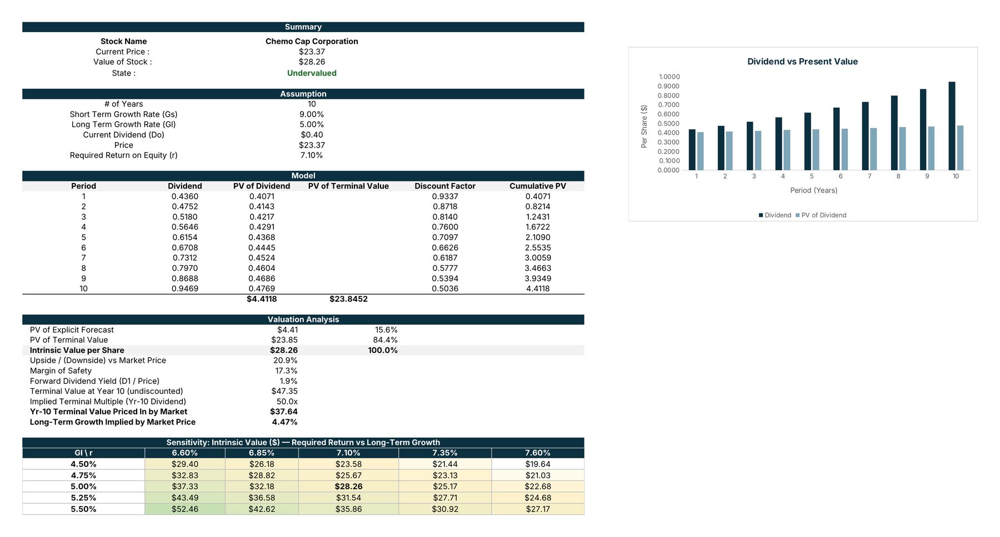

# Chemo Cap Corporation — Two-Stage Dividend Discount Model

A two-stage dividend discount model (DDM) valuing Chemo Cap Corporation's equity, built in Excel with a reverse-engineered market view and a required return vs long-term growth sensitivity grid.



## Overview

The model projects Chemo Cap's dividend through a 10-year high-growth stage, discounts each payment at the required return on equity, then caps the forecast with a Gordon Growth terminal value on the Year 11 dividend. The result is compared with the current share price to give a clear Undervalued / Overvalued call, and the market price is worked backwards to show what growth rate investors are already paying for.

**Valuation summary:**
- **Intrinsic value per share: $28.26**, against a $23.37 current share price — **20.9% upside**
- **Margin of safety: 17.3%** — the stock screens as **Undervalued**
- **PV of the 10-year dividend stream: $4.41** (15.6% of value); **PV of terminal value: $23.85** (84.4%)
- **Market-implied long-term growth: 4.47%**, against the 5.00% assumed — the market is pricing in slightly slower long-run growth than the model

## Model structure

The model sits on a single **Two Stage DDM** sheet, laid out top to bottom:

| Section | Purpose |
|---|---|
| **Summary** | Stock name, current price, intrinsic value and the Undervalued / Overvalued call |
| **Assumption** | All inputs in one block: forecast years, short- and long-term growth, current dividend, price, required return |
| **Model** | Year-by-year dividend, discount factor, PV of dividend and cumulative PV, plus the PV of terminal value |
| **Valuation Analysis** | Value split between forecast and terminal stages, upside, margin of safety, forward yield, implied terminal multiple and market-implied growth |
| **Sensitivity** | Intrinsic value across required return (6.60%–7.60%) and long-term growth (4.50%–5.50%) |
| **Chart** | Dividend vs present value by year, showing how discounting erodes later payments |

## Key assumptions

- **Current dividend (D0): $0.40** per share
- **Stage 1:** 10 years of dividend growth at **9.00%**
- **Stage 2:** perpetual growth at **5.00%** from Year 11
- **Required return on equity: 7.10%**
- **Current share price: $23.37** (forward dividend yield of 1.9%)
- Terminal value at Year 10 of $47.35, an implied **50.0x** multiple of the Year 10 dividend

## Sensitivity

Intrinsic value ranges from **$19.64** (7.60% required return, 4.50% growth) to **$52.46** (6.60% required return, 5.50% growth). With 84% of value in the terminal stage, the spread between required return and long-term growth is the single biggest driver: a quarter-point move in either shifts the value by roughly $2.50 to $4.00 a share.

## Tools

- **Microsoft Excel** — dividend projection, discounting, terminal value, reverse-engineered implied growth, sensitivity grid and chart

## Repo contents

```
├── Model/
│   ├── Chemo Cap Corporation - 2 Stage DDM.xlsx   # The full model
│   └── Chemo Cap Corporation - 2 Stage DDM.pdf    # Printable/read-only export
└── Assets/
    └── ddm-preview.png                            # Model output screenshot
```

## Getting started

1. Open `Model/Chemo Cap Corporation - 2 Stage DDM.xlsx` in Excel.
2. Change any input in the **Assumption** block (growth rates, dividend, price or required return).
3. The **Model**, **Valuation Analysis**, **Sensitivity** grid, chart and the Undervalued / Overvalued call in **Summary** all update automatically.

---
*This model is prepared for illustrative and analytical purposes only and does not constitute investment advice. Figures are estimates based on stated assumptions and are subject to change.*

**Prepared by:** Chungu Kapambwe
